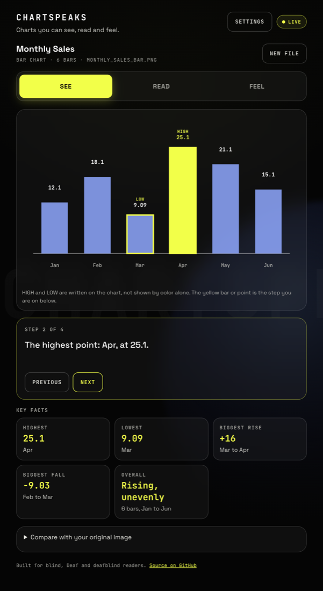
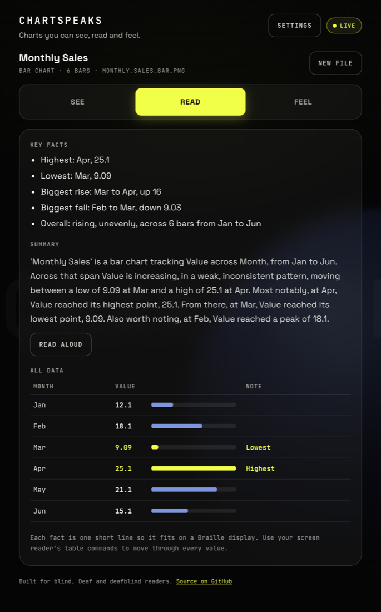
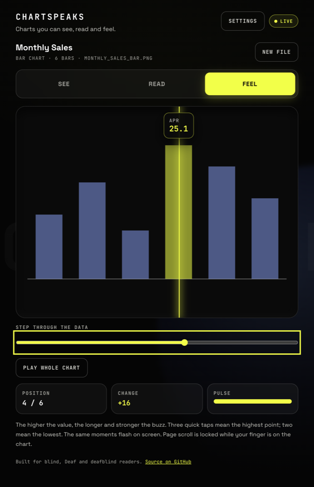

# ChartSpeaks

**Charts you can see, read and feel.** Upload a picture of a bar or line chart and ChartSpeaks reads the numbers off it, works out what matters, and gives the chart back three ways, so blind, Deaf and deafblind readers each get the whole story.

**Try it:** https://jaivarshanv.github.io/chartspeaks/ (no chart handy? press *Bar chart* under "Try a sample")

| See | Read | Feel |
|---|---|---|
|  |  |  |

## Three ways into one chart

| Tab | Built for | What you get |
|---|---|---|
| **See** | Deaf and hard-of-hearing readers | The chart redrawn with every value labelled, HIGH and LOW written on it (not shown by color alone), plain-language fact cards, and a self-paced, captioned step-through of the moments that matter. Nothing needs sound. |
| **Read** | Screen reader and Braille display users, blind and deafblind | One fact per short line so each fits on a Braille display, a real data table, and a written summary. *Read aloud* speaks one sentence at a time and highlights it as a caption. |
| **Feel** | Touch, including deafblind readers | Drag across the chart to feel it: the higher the value, the stronger the buzz; three taps mark the highest point, two the lowest. A slider steps point by point with one pulse per step, and its text ("Apr: 25.1, the highest. 4 of 6.") reaches a screen reader or Braille display. Every buzz also flashes on screen. |

Settings for text size, calm motion, reading aloud and vibration are saved on your device. Vibration needs an Android phone in Chrome or Firefox; iPhones and most computers can't vibrate, and the page says so.

## How it works

```
chart image ──► image_extractor.py ──► analyzer.py ──► salience.py ──► narrator.py ──► ChartSpeaks.dc.html
 (PNG/JPG)      OCR + computer vision   trend, range,    ranks what      plain-language   See / Read / Feel
                reads axes and values   changes, peaks   matters most    summary
```

- **No guessed numbers.** The extractor is deterministic computer vision plus Tesseract OCR, not an AI model. Every value is measured off the image, and if it can't read a chart confidently it says why instead of making something up.
- **Narration is grounded.** The summary is built only from computed facts. An optional LLM can phrase it more naturally (set `ANTHROPIC_API_KEY`), and its output is thrown away unless every number traces back to the analysis.
- CSV (Chart4Blind export) and JSON uploads skip the image step.

## What it can read

- Clean, computer-made **line charts** and **vertical bar charts** (single color, a color per bar, grouped bars, negative bars), e.g. Excel, Google Sheets or matplotlib exports and clean screenshots.
- Not yet: pie charts, horizontal or stacked bars (stacked bars are detected and refused rather than misread), photos of hand-drawn charts, and rotated Y-axis titles.

Values from images are measurements, so they're shown to about three significant figures.

## Run it locally

You need Python 3.12 and the Tesseract OCR engine (`brew install tesseract`, or `sudo apt-get install tesseract-ocr`).

```bash
python3.12 -m venv .venv && source .venv/bin/activate
pip install -r requirements.txt
uvicorn api:app --reload                # API on http://127.0.0.1:8000
python3 -m http.server 8080             # in a second terminal
open "http://localhost:8080/?api=http://127.0.0.1:8000"
```

Or run the API in Docker: `docker build -t chartspeaks . && docker run -p 8000:8000 chartspeaks`.

Run the tests with `pytest`. The API is documented in [API_CONTRACT.md](API_CONTRACT.md), and interactive docs are at `/docs` on a running server.

## Project layout

| Path | What it is |
|---|---|
| `ChartSpeaks.dc.html` | The whole frontend (rendered by `support.js`); `index.html` forwards to it |
| `api.py` | FastAPI app: `/analyze-file` (upload) and `/analyze` (JSON) |
| `image_extractor.py` | Chart image → data: plot area, OCR'd axes, bars or line |
| `analyzer.py`, `salience.py`, `narrator.py` | Analysis, ranking, and the written summary |
| `tests/` | Real fixture images with known values, end to end |
| `prototypes/shape-tracker.html` | The haptics prototype the Feel tab grew from |

## Accessibility status

Checked with automated browser tests: keyboard-only use, focus moving to each new screen, ARIA tabs, live regions, the slider's value text, phone-width layout, and color contrast. It hasn't yet been tested with blind, Deaf or deafblind readers using their own screen readers and Braille displays. If you are one, issues and feedback are very welcome.

## Team

Jaivarshan V, Hasini, Harnoor Kaur, Keshav Biyani and C Vishwajeet Kumar.
